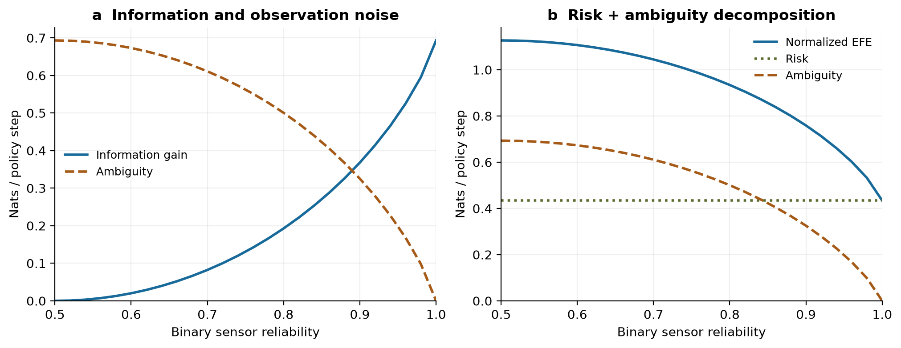
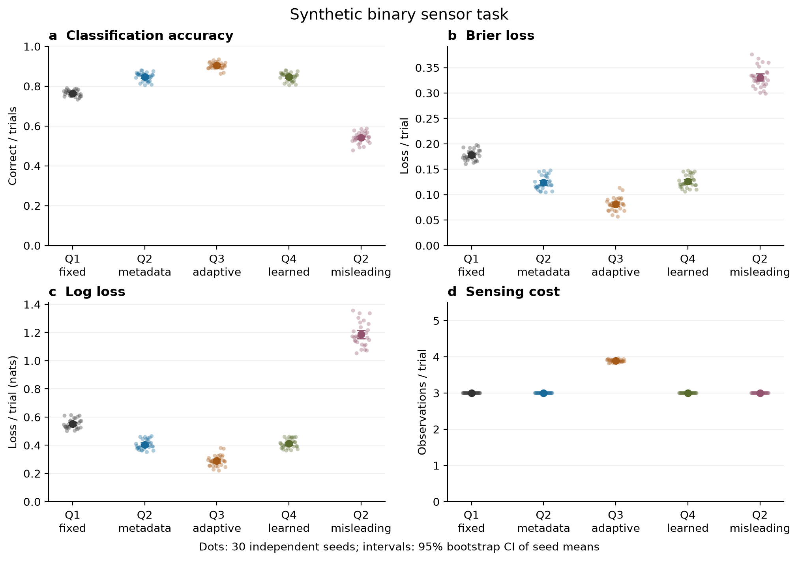

# Abstract {#sec:abstract}

Active inference separates belief updating and policy evaluation from the specification of the model in which they occur. We interpret specification of observation likelihoods, dynamics, outcome preferences, and initial beliefs as a meta-epistemic and meta-pragmatic activity. A two-by-two framework distinguishes data from metadata, and object-level processing from monitoring or revision of that processing. The four quadrants are an analytical taxonomy, not a claim about four natural cognitive kinds. We supply a discrete categorical implementation, explicit probability contracts, exact variational-free-energy checks, and a reproducible synthetic binary sensor experiment. Across 30 independent seeds with 400 held-out trials each, reliability-aware inference achieves 84.68% accuracy versus 76.36% for a homogeneous-reliability baseline. Adaptive acquisition reaches 90.34% while using 3.89 observations per trial versus three for the baseline. Reliability estimated from separate labeled training achieves 84.68%; misleading reliability metadata reduces accuracy to 54.12%. Paired seed-level intervals and multiplicity-adjusted tests accompany these results. They demonstrate properties of the specified task and mechanisms, rather than general superiority of meta-cognition, proof of the free energy principle, or validated security defenses. We identify model revision, calibration, metadata provenance, and bounded adaptation as concrete research variables.

**Keywords:** active inference; expected free energy; meta-cognition; model specification; metadata reliability; reproducible simulation


---


# Introduction {#sec:introduction}

An agent can infer correctly under an inappropriate observation model or select the minimum-cost policy under inappropriate preferences. In either case, improving the inference algorithm alone may leave the error intact. This distinction motivates examining how a model is specified, evaluated, and revised.

We use *meta-epistemic* for choices about the representation and acquisition of evidence, and *meta-pragmatic* for choices about preferences and the evaluation of action. These are interpretive terms for modeling activities. They do not imply that ordinary parameter estimation is impossible or that an agent's initial ontology is irrevocable. Observation and transition models can be learned; the selection of representations, update rules, and constraints remains a modeling decision.

Our contribution is a taxonomy connecting these activities to inspectable computational mechanisms. We distinguish data from information about its source or reliability, and direct inference from evaluation of inference. The resulting quadrants organize examples and failure cases. Their usefulness depends on operational definitions and comparative tests; the taxonomy itself does not guarantee improved performance.

The paper contributes (1) explicit definitions of the four quadrants, (2) a categorical implementation with shared probability conventions and mathematical identity tests, (3) matched synthetic comparisons with retained trial-level evidence, and (4) a scoped discussion of metadata manipulation and model revision. Active inference is not the only framework in which these questions arise. Reinforcement learning, Bayesian decision theory, active learning, and meta-learning also permit learned models, structured objectives, and information-seeking behavior.

Section [3](#sec:related_work) places the interpretation in its research context. Section [4](#sec:background) defines the numerical conventions. Sections [5](#sec:methodology) and [6](#sec:quadrant_model) give the experimental design and operational taxonomy. Sections [7](#sec:security), [8](#sec:discussion), and [9](#sec:conclusions) delimit the implications. The appendix and retained artifacts provide the audit trail.


---


# Related Work {#sec:related_work}

## Active inference and model specification

The free energy principle and discrete active inference supply the background for the distinction between state inference and model specification [@friston2010free; @dacosta2020active]. Expected free energy balances information gain and outcome preferences under a predictive model [@friston2015epistemic]. The variational assumptions behind planning require care: expected free energy is not obtained by simply substituting future observations into the usual variational objective [@millidge2021whence]. Our implementation is deliberately limited to categorical models with known likelihood and transition matrices.

Methods and software already address learning, hierarchical models, and practical computation [@friston2016active; @smith2022step; @heins2022pymdp]. Thus, our meta-level interpretation does not introduce model learning to active inference. Its contribution is a classification of specification and monitoring choices, coupled to explicit examples that can be checked computationally.

Recent work studies scale-free generative models, variational planning, and interpretable graph-based agents [@friston2025scalefree; @devries2025planning; @feps2025]. These are distinct technical architectures, not implementations or validation of the quadrants proposed here. We include them to clarify the surrounding research program, without importing their performance claims into our results.

## Monitoring, control, and calibration

The distinction between monitoring and control predates this taxonomy [@flavell1979metacognition; @nelson1990metamemory]. Confidence, calibration, discrimination, and metacognitive efficiency are different quantities [@fleming2014measure]. A concentrated posterior can be confidently wrong under model misspecification. Accordingly, the experiment reports Brier loss and log loss rather than treating posterior concentration as evidence of correctness.

MetaMind and SOFAI provide contemporary examples of metacognitive organization in artificial systems [@metamind2025; @sofai2025]. Their tasks and mechanisms differ from our binary sensor setting. An architectural analogy does not establish shared statistical behavior or biological equivalence.

## Relation to reinforcement learning and Bayesian decision theory

The difference between specifying outcome preferences and specifying rewards is useful, but it is not an absolute division between inspectable and opaque objectives. If preferences are encoded as $p_C(o)\propto\exp(\beta r(o))$, the expected log-preference term corresponds to expected reward up to a scale and normalization constant. Epistemic value adds a particular information-seeking objective. Active inference and model-based reinforcement learning have operational connections [@tschantz2019scaling; @sajid2021active]; both require assumptions about observations, actions, and values.

Our question is therefore comparative: which explicit reliability or monitoring mechanism changes behavior under a specified environment and resource budget? The four labels do not determine the answer in advance.

## Safety and information integrity

Objective specification, distribution shift, and oversight are established concerns in AI safety [@amodei2016concrete; @gabriel2020artificial]. We use the quadrants to organize where an intervention acts: on observations, metadata, monitoring rules, or model revision. We do not infer human susceptibility, attack success probabilities, or alignment guarantees from the taxonomy. The misleading-metadata control is a controlled synthetic failure case, not a deployment security evaluation.


---


# Background and Numerical Conventions {#sec:background}

## Discrete generative model

Let $s$ index hidden states, $o$ observations, and $a$ actions. The implementation uses $A_{o,s}=p(o\mid s)$, $B_{s',s,a}=p(s'\mid s,a)$, finite outcome preference logits $C_o$, and a normalized initial prior $D_s$. Columns of $A$ and of each action slice of $B$ sum to one. A two-dimensional $B$ is promoted to a single-action tensor. Arrays with incompatible dimensions, empty axes, negative probabilities, nonfinite values, or invalid normalization are rejected.

The normalized outcome preference is $p_C(o)=\exp(C_o)/\sum_j\exp(C_j)$. Logits are not probabilities; adding a constant to all entries leaves the normalized preference unchanged. Model validation copies inputs so that later mutation of caller-owned arrays does not silently change an initialized model. Public model arrays remain inspectable and mutable; callers must validate deliberate revisions.

## Bayesian state inference

For a categorical observation, Bayes' rule gives:

::: {#eq:bayes}
$$
q(s\mid o)=\frac{A_{o,s}D_s}{\sum_j A_{o,j}D_j}.
\tag{1}
$$
:::

For a normalized nonnegative virtual-evidence vector $e(o)$, the implementation uses $L_e(s)=\sum_o e(o)A_{o,s}$ and replaces $A_{o,s}$ with $L_e(s)$ in Equation [(1)](#eq:bayes). This convention models evidence about possible outcomes. It differs from a Jeffrey update, which mixes already-conditioned posteriors. A uniform evidence vector is uninformative because each likelihood column sums to one. Zero-probability states retain zero mass; evidence impossible under the model and prior raises an error instead of being repaired by clipping.

## Variational free energy

Given an explicit joint distribution and a normalized candidate posterior $q$, variational free energy is:

::: {#eq:vfe}
$$
F(q,o)=\sum_s q(s)\left[\log q(s)-\log p(o,s)\right]
=-\log p(o)+D_{\mathrm{KL}}\left[q(s)\Vert p(s\mid o)\right].
\tag{2}
$$
:::

Equation [(2)](#eq:vfe) bounds negative log evidence and reaches the bound at the exact posterior. Candidate beliefs assigning positive mass outside posterior support have infinite free energy. The exact implementation is `calculate_variational_free_energy`; the older model-free `FreeEnergyPrinciple.calculate_free_energy` path remains an explicitly labeled schematic score for compatibility. Its trajectories and state-boundary diagrams do not establish a variational bound, conditional independence, or the physical claims of the FEP. Supplying a generative model to that class selects the exact calculation.

## Expected free energy

For each future policy step, propagate $q_\tau=B(a_\tau)q_{\tau-1}$ and predict $q_o=Aq_\tau$. With an exact conditional update, state information gain is $I(s;o)=H(q_o)-\sum_s q_\tau(s)H(A_{:,s})$. Our normalized planning score is:

::: {#eq:efe}
$$
G_\tau=-I(s;o\mid\pi)-\sum_o q_o(o)\log p_C(o)
=D_{\mathrm{KL}}[q_o\Vert p_C]+\sum_s q_\tau(s)H(A_{:,s}).
\tag{3}
$$
:::

The equivalence in Equation [(3)](#eq:efe) follows by expanding mutual information and KL divergence. It is exact for this finite, known-likelihood predictive model. It does not include uncertainty about parameters, posterior approximation error, or observation-contingent replanning.

For compatibility, the returned `total` uses the raw-logit score $-I-\mathbb{E}[C]$. `normalized_total` adds `logsumexp(C)` per step and equals risk plus ambiguity. Normalized values are evaluated directly from stable log preferences to avoid cancellation under large constant logit shifts. Policy rankings agree mathematically for a fixed model and horizon convention. Mean aggregation is the legacy default; sum aggregation implements additive finite-horizon costs. Comparing different horizons or different preference models requires specifying this convention and normalization explicitly.

Policy selection accepts current posterior beliefs, with $D$ used when beliefs are omitted. It returns an argmin and a policy distribution proportional to $\exp(-\gamma G)$, where $\gamma>0$ is precision. Increasing precision concentrates this distribution; it does not change an exact argmin. Equal scores retain a uniform distribution. All entropy and KL quantities use natural logarithms and are measured in nats.

{#fig:efe_sensitivity width=95%}


---


# Methodology {#sec:methodology}

## Study type and inferential scope

This is a conceptual framework with a synthetic computational demonstration. The taxonomy was not derived from empirical clustering and is not tested as a biological partition. The experiment tests concrete mechanisms inspired by its quadrants. The mechanisms are implemented in `src/analysis/experiments.py`; the narrative quadrant class supplies definitions and examples, rather than four independently validated algorithms.

The design below is fixed in code and recorded in each output manifest. It is not a preregistered study. Historical numerical claims in earlier manuscript versions lacked a corresponding experiment and are superseded by the retained results reported here. No participant data, clinical outcomes, or deployment incidents are analyzed.

## Generative task and controls

Each test trial independently draws a binary hidden state from a uniform prior. Five conditionally independent binary sensors agree with that state with probabilities $(0.55,0.65,0.85,0.80,0.80)$. Every strategy sees the same pre-generated test states and observations within a seed. The first three sensors are the common initial evidence. The state remains fixed within a trial and resets independently between trials.

- **Q1 fixed:** inference assumes reliability 0.80 for each of the first three sensors.
- **Q2 metadata:** inference uses the true, sensor-specific reliabilities for the same three observations. This is an oracle-metadata condition.
- **Q3 adaptive:** starts from Q2, then acquires a fourth and, if needed, fifth observation while the maximum posterior probability is below 0.90. Its cost is the actual observation count, with a maximum of five.
- **Q4 learned:** estimates the first three reliabilities from 200 separate labeled training trials per seed, using a Beta(1,1) prior. Parameters are frozen before held-out evaluation. It uses exactly three test observations.
- **Misleading metadata:** uses claimed reliabilities $(0.95,0.85,0.55)$ for the first three sensors. This prespecified adverse control reverses the ordering of sensor quality.

Q3 changes available evidence, whereas Q4 changes fitted likelihood parameters. They are not matched to Q1 on every resource. We report these differences rather than attributing all gains to a generic meta-level capacity. The confidence score controlling Q3 is maximum posterior probability; it is not the composite heuristic returned by `MetaCognitiveSystem`.

## Replication, randomness, and outcomes

Thirty independent seeds (0--29) generate 400 held-out trials each. A `SeedSequence` spawns distinct training and test streams. Labels from test trials are used only for scoring. The training and held-out streams are not used to tune the threshold, prior, or hypotheses. Equal posterior probabilities select state zero deterministically.

The primary outcome is held-out accuracy. Secondary descriptive outcomes are mean Brier loss, logarithmic loss in nats, and observations per test trial. Lower loss is better. Accuracy alone may conceal confidence errors, and a high posterior is not evidence of calibration under misspecification.

The three directional predictions concern (H1) Q2 versus Q1 accuracy, (H2) Q3 versus Q2 accuracy with additional sensing, and (H3) Q4 versus Q1 accuracy after separate training. The comparisons are operationalizations of these mechanisms, not claims that every quadrant extension improves accuracy. Two-sided tests retain the possibility of harm.

## Statistical analysis

The inferential unit is a seed-level mean, yielding 30 paired replicates per comparison; the 12,000 test trials are not treated as 12,000 independent agent replicates. The common-random-number design reduces comparison noise. We report mean paired differences with 95% percentile-bootstrap intervals from 5,000 resamples of seeds, using bootstrap seed 42. Intervals are marginal, not simultaneous family-wise intervals.

Primary test evidence is a two-sided paired sign-flip test using 10,000 Monte Carlo resamples (seed 2718) with a plus-one correction. Its validity requires exchangeability of signs under the paired null; it is not an exact finite-sample test for arbitrary differences. Holm correction applies to the family of three primary comparisons. Paired t-tests and standardized within-pair differences $d_z=\overline{\Delta}/s_\Delta$ are supplementary. Effect-size conventions are explicit; large standardized differences across low-noise seed averages do not imply large population effects in human cognition.

The pipeline also checks 200 two-step policy evaluations across 50 randomly generated models against the risk-plus-ambiguity identity, and checks the VFE evidence decomposition. These check the implementation under specified numerical contracts, not the truth of the FEP as a physical theory. Deterministic and impossible-evidence cases are included in regression tests.

## Evidence retention

`results/trials.csv` retains test states, sensor outcomes, strategy probabilities, and Q3 sensing counts. `results/replicates.csv` retains all seed-level metrics. `results/summary.json` contains intervals, tests, design parameters and limitations; `results/efe_sensitivity.csv` contains the exact curves. `results/manifest.json` hashes source files, configuration, environment versions and output artifacts. The Git revision is the base revision; source digests identify the executed working-tree content.

{#fig:quadrant_experiment width=95%}


---


# The Two-by-Two Quadrant Framework {#sec:quadrant_model}

## Operational definitions

The horizontal axis distinguishes observations from information about their production, reliability, or provenance. The vertical axis distinguishes performing inference from monitoring, evaluating, or revising inference. A datum can be metadata relative to one task and ordinary data relative to another; classification must therefore specify the object-level task and monitored process.

| | Data | Metadata |
|---|---|---|
| Object-level cognition | Q1: infer states and evaluate actions | Q2: condition inference on source reliability or context |
| Meta-cognitive regulation | Q3: monitor uncertainty and alter processing or acquisition | Q4: evaluate or revise the reliability model, strategy, or representation |

The axes are analytically distinguishable, but we do not assert statistical independence or universal neural separability. One implementation can contain operations assigned to several quadrants. Neither a timestamp nor a confidence value alone makes a system meta-cognitive; there must be a specified monitoring/control relation.

## Q1: direct inference and policy evaluation

Q1 includes Equation [(1)](#eq:bayes) and policy evaluation in Equation [(3)](#eq:efe) under a fixed model. The experimental Q1 baseline uses the same inference rule as the other conditions, with a homogeneous reliability assumption. Its weakness is model misspecification, rather than the absence of any Bayesian operation. Correctly specified Q1 inference can match a metadata-aware strategy when metadata carries no additional information.

## Q2: reliability and context

Q2 uses metadata $m$ by conditioning the likelihood, $p(o\mid s,m)$. In the sensor example, $m$ identifies sensor-specific reliability. This changes the evidence supplied to the same Bayesian update. The gain is conditional on the metadata being informative and trustworthy. If metadata is irrelevant, unavailable, or false, it may yield no gain or cause harm.

An alternative weighted score $\widetilde G=w_e(-I)+w_p(-\mathbb E[C])+w_m K(m)$ can be useful as a designed decision objective. Arbitrary weights and an added metadata cost do not automatically preserve a variational derivation. Such scores must be labeled heuristics unless a corresponding generative model and derivation are supplied.

## Q3: monitoring and bounded control

Q3 observes a property of the inference process and changes what the system does next. Here, maximum posterior probability determines whether another observation is acquired. The monitoring rule is bounded by an explicit sensing budget. The mechanism improves accuracy when new observations are sufficiently informative, but incurs cost and can fail under miscalibrated beliefs.

Posterior entropy and maximum posterior probability describe belief concentration. Calibration requires comparison with realized outcomes. The package's composite confidence and attention examples are illustrative control rules; their weights are not fitted psychological parameters or calibrated probabilities of correctness.

## Q4: model evaluation and revision

Q4 evaluates the reliability model and changes its parameters. The implemented mechanism estimates likelihood reliabilities on a separate labeled training set and freezes them before test. This is model-level adaptation under external supervision. It is not unrestricted self-modification, a learned ontology, or evidence that an agent can independently choose appropriate goals.

A general framework-revision objective may combine predictive fit, resource cost, and constraints on permissible changes. The choice of those terms requires justification; lowering an in-sample objective is not enough. Held-out evaluation and bounded update rules distinguish improved fit from overfitting or drift. Revising preferences also requires an external criterion for whether the revision is desirable.

## Integration and falsifiability

The framework suggests testable contrasts: informative versus uninformative metadata, matched versus mismatched models, fixed versus adaptive sensing under comparable cost, and training-based revision versus held-out controls. A useful taxonomy should help define these contrasts without predetermining their outcomes. Evidence against a particular mechanism should remain possible. The current study gives one tractable example; broader tasks, correlated sensors, nonstationarity, and representation learning are future tests.


---


# Security and Information Integrity {#sec:security}

## Scoped threat model

We consider an attacker able to change observations, reported reliability, monitoring rules, or selected model parameters in a categorical artificial agent. The assets are the fidelity of state estimates, the integrity of preferences, and the validity of model revisions. We assume the evaluation state and held-out scoring code remain trusted. This is a conceptual and synthetic threat model; it does not establish attack prevalence, impact in deployed systems, or human cognitive vulnerability.

| Intervention | Example | Evidence or limitation |
|---|---|---|
| Observations (Q1) | Alter a sensor outcome | Can be studied as a controlled observation perturbation |
| Metadata (Q2) | Overstate reliability of a weak sensor | Measured adverse control in the binary task |
| Monitoring (Q3) | Alter a confidence threshold or sensing budget | Requires a separate monitoring-rule intervention |
| Model revision (Q4) | Poison training labels or permit preference drift | Requires a trusted update reference and held-out evaluation |

These locations need not be exclusive. Altering a likelihood matrix may affect both direct inference and metadata-conditioned inference. There is no measured monotonic ranking of danger or detectability across Q1--Q4.

## Measured metadata failure

The misleading-metadata condition claims high reliability for the weakest sensor and low reliability for the strongest. Held-out accuracy falls to 54.12%, compared with 84.68% under truthful reliability metadata. Log loss also increases. This demonstrates a specific misspecification failure under known ground truth. It does not establish the effectiveness of a detector, defense, or real-world influence operation.

## Diagnostics and their limits

`CognitiveSecurityAnalyzer.detect_anomaly` requires valid normalized belief distributions before applying a disclosed smoothing epsilon to KL divergence. The smoothing makes the diagnostic finite when a baseline assigns zero mass, and therefore it is not the unsmoothed support-sensitive KL used in the exact inference identities. Thresholds are user-specified and are not calibrated false-positive rates. Distribution shift can be benign, and an attack can remain close to a baseline.

`validate_framework_integrity` checks shape, finiteness, compatibility, nonnegativity, and stochasticity. A malicious model can satisfy every one of these contracts. Structural validity therefore cannot establish absence of tampering. The result explicitly records that tamper absence was not verified. The attack-surface scores and Gaussian parameter-drift demonstrations are author-specified illustrations, not measured risk scores or probability-preserving attack simulations.

## Bounded safeguards and open questions

A practical system can record trusted parameter versions, verify input provenance, constrain allowed revisions, retain rollback points, and test candidate changes on held-out data. These are design proposals requiring separate evaluation. Model hashes establish byte identity against a trusted reference; they do not establish the truth or appropriateness of that reference.

Preference specification remains a normative choice. An inspectable $C$ vector can help make that choice discussable, but its mathematical representation does not ensure alignment with human values [@gabriel2020artificial; @amodei2016concrete]. Future security experiments should state attacker capabilities, clean and attacked distributions, detector calibration data, resource budgets, and false-positive/false-negative tradeoffs. No security efficacy claim is made here.


---


# Discussion {#sec:discussion}

## Interpretation of the numerical results

The experiment supports a narrow conclusion: using accurate source reliability can improve a misspecified inference baseline, and additional evidence can improve accuracy at additional cost. Estimating reliability from labeled training approximates the oracle condition in this task. These findings are compatible with standard Bayesian model specification and sequential evidence acquisition. They do not require that the four quadrants correspond to distinct computational or biological faculties.

Q2 and Q4 produce identical held-out classification accuracy in the retained run, while their Brier and log losses differ. In this parameter regime, fitted likelihood weights preserve the ordering of classification decisions across seeds. Equal accuracy therefore does not imply identical beliefs or perfect parameter recovery. Conversely, a sizable standardized seed-level effect largely reflects small variation in replicate means, so absolute percentage-point differences and sensing costs deserve priority.

## Contribution of the taxonomy

The taxonomy makes three questions explicit: what evidence is modeled, what information is available about its reliability, and which part of processing can be monitored or revised. It connects model specification to testable interventions and makes assumptions inspectable. It does not supersede established work on learning, monitoring/control, active learning, or hierarchical inference.

Changing $A$, $B$, $C$, or $D$ has different meanings: observation model revision, dynamics revision, preference revision, and prior revision. These should not all be treated as the same form of optimization. Empirical fit can assess some epistemic revisions, whereas preference revision additionally needs a justified normative reference.

## Limitations {#sec:limitations}

The task has two states, conditionally independent sensors, fixed reliabilities, and no changing state within a trial. Labels are available for training Q4, and true reliability is supplied to Q2/Q3. Q3 receives a larger sensing budget. Those assumptions favor the tested mechanisms; correlated observations, incorrect metadata, changing reliability, and costly acquisition can alter the result.

The experiment evaluates state estimation and sensing, not a full partially observable control task or long-horizon planning. EFE is checked separately through exact mathematical identities and a reliability sweep. No claim is made that the synthetic accuracy gains were caused by EFE policy selection. The package's narrative framework/modeler classes and schematic FEP visualizations remain educational demonstrations.

Confidence intervals concern this simulation design. Bootstrap seed resampling approximates variability over independent generated datasets, not uncertainty about all possible environments. Sign-flip tests require a symmetric/exchangeable null; they are supplementary to retained estimates and model assumptions. The three primary tests use Holm correction, while the displayed 95% intervals are marginal. No retrospective power calculation or fabricated regression fit is reported.

The manuscript is a working research document, without claimed peer review or independent replication. Bibliographic corrections are documented separately; bibliography links establish source identity, not independent confirmation of every interpretation. Synthetic failures do not support clinical or deployment guidance.

## Next empirical tests

Useful next tests would compare equal sensing budgets, include model-free and model-based decision baselines, introduce correlated and shifting sensor noise, vary training-label availability, and evaluate metadata provenance or corruption detectors on held-out attacks. Representation-changing Q4 mechanisms require complexity penalties and external evaluation. A biological study would need measured behavior, confidence reports, a fitted model, and appropriate metacognitive measures [@fleming2014measure], rather than mapping the quadrant labels directly onto neural structures.


---


# Conclusion {#sec:conclusions}

Active inference makes observation likelihoods, dynamics, preferences, and priors explicit modeling objects. We interpret decisions about these objects as meta-epistemic and meta-pragmatic activities and organize examples with a data/metadata by cognition/meta-cognition taxonomy. The taxonomy is useful when it clarifies a mechanism, a comparison, and a possible failure, rather than when it merely assigns a higher-order label.

The implementation now exposes consistent probability conventions, categorical and soft-evidence inference, normalized EFE decompositions, exact variational bounds, and reproducible experiment artifacts. In the specified binary sensor task, reliability-aware inference improves accuracy over a homogeneous-reliability baseline, adaptive sensing improves accuracy with additional observations, and supervised reliability fitting approximates an oracle model. Misleading metadata causes a substantial failure. These outcomes delimit the claim: better-specified or better-informed models can help, but monitoring and revision require resources, evidence, and constraints.

The next research step is to test those mechanisms under richer environments and matched budgets. The current study supplies an inspectable starting point and an audit trail, without claiming universal performance benefits, biological validation, or security guarantees.


---


# Acknowledgments and Research Transparency {#sec:acknowledgments}

This work builds on the active inference, Bayesian modeling, and metacognition literature cited throughout. Citation does not imply endorsement by the cited researchers.

The reported experiment uses synthetic data only. No human or animal participants are involved. No funding, competing-interest, institutional affiliation, or publication-status declaration is inferred from the repository; the author should supply any required declarations before submission.

The manuscript, implementation, generated data, and figure sources are retained with configuration and source hashes. The software is distributed under the repository's Apache-2.0 license. The author is responsible for the final scientific claims and bibliographic details.


---


# Appendix {#sec:appendix}

## Derivation checks {#sec:mathematical_foundations}

Expanding $D_{\mathrm{KL}}(q_o\Vert p_C)$ gives $-H(q_o)-\mathbb E[\log p_C]$. Adding ambiguity $\mathbb E_{q_s}H(A_{:,s})$ gives $-I(s;o)-\mathbb E[\log p_C]$, establishing Equation [(3)](#eq:efe). Replacing normalized log preferences with logits subtracts $\log\sum_o\exp(C_o)$ per policy step. This constant affects reported magnitudes but not a fixed-model, fixed-convention policy ranking.

For VFE, substitute $p(o,s)=p(s\mid o)p(o)$ into Equation [(2)](#eq:vfe). The log-evidence term factors out of the normalized expectation, leaving posterior KL divergence. With $q=p(s\mid o)$ the divergence is zero. Exact-zero handling uses $0\log0=0$ and retains infinite divergences for support violations.

Tests additionally compare batched binary log-odds inference with sequential core Bayesian updates, check asymmetric column-stochastic transitions, and check preference-shift and horizon-aggregation identities. Mathematical identity tests complement software coverage; coverage alone does not establish theoretical correctness.

## Retained experiment results {#sec:validation_results}

| Condition | Accuracy (%) | Brier loss | Log loss (nats) | Observations/trial |
|---|---:|---:|---:|---:|
| Q1_fixed | 76.36 | 0.1781 | 0.5519 | 3.000 |
| Q2_metadata | 84.68 | 0.1235 | 0.4051 | 3.000 |
| Q3_adaptive | 90.34 | 0.0812 | 0.2896 | 3.892 |
| Q4_learned | 84.68 | 0.1258 | 0.4114 | 3.000 |
| Q2_misleading | 54.12 | 0.3306 | 1.1861 | 3.000 |

| Contrast | Difference (percentage points) | 95% bootstrap interval | Paired d_z | Holm sign-flip p |
|---|---:|---|---:|---:|
| H1 | 8.325 | [7.442, 9.217] | 3.439 | 0.00030 |
| H2 | 5.658 | [5.058, 6.267] | 3.275 | 0.00030 |
| H3 | 8.325 | [7.442, 9.217] | 3.439 | 0.00030 |

These estimates are computed from `results/summary.json`. Each comparison uses 30 paired seed means. The primary p-values are Monte Carlo sign-flip estimates at finite resolution, with Holm correction across H1--H3. The intervals are marginal percentile-bootstrap intervals; they are not adjusted simultaneous intervals. The supplementary paired t-tests and full seed-level data are retained in the artifact set.

## Implementation and complexity {#sec:implementation_architecture}

`core` defines categorical models and exact inference. `framework` supplies the taxonomy, monitoring illustrations, and structural security diagnostics. `analysis` contains generators, statistics, validation, experiments, and pipeline orchestration. `visualization` creates educational and experiment figures; `utils` supplies manuscript validation and provenance. No parent repository infrastructure is required by the research pipeline.

For a dense model with S states, O observations, A candidate actions and horizon H, a single H-step policy costs approximately $O(H(S^2+OS))$ for transitions and predictions, with $O(OS)$ likelihood entropy preprocessing. Evaluating K candidate policies multiplies the per-policy cost by K. The implementation does not claim sparse scaling or measured support for 1,000-state models. No runtime table is reported without a retained benchmark protocol and hardware description.

## Reproduction protocol {#sec:reproducibility}

Run from a clean checkout:

```bash
uv sync --locked --extra dev --extra research --python 3.12
MPLBACKEND=Agg uv run --python 3.12 pytest --cov=src --cov-report=term-missing
uv run --python 3.12 python scripts/07_analysis_pipeline.py
```

The pipeline writes the source-backed results and standalone HTML manuscript to `results/`. Changing seed counts, trial counts, training size, numerical libraries or model configuration creates a different run, which must be described as such. Random-number generators are local; reproducibility does not rely on global `numpy.random.seed`. Source and output digests support verification within a recorded environment. PDF figure metadata or library/platform differences can change binary hashes without changing numerical estimates.

The older scripts 01--05 generate educational diagrams under `../figures/`; those illustrations are separate from the retained experiment evidence. Script 06 validates the manuscript rather than inserting unreviewed or stale figures automatically.


---


# Symbols and Glossary {#sec:symbols}

| Symbol | Meaning and convention |
|---|---|
| $s,s'$ | Current and destination hidden states |
| $o,a,\pi$ | Outcome, action, and open-loop action sequence |
| $A_{o,s}$ | Column-stochastic observation likelihood |
| $B_{s',s,a}$ | Column-stochastic state transition for action $a$ |
| $C_o$ | Finite outcome preference logit |
| $D_s$ | Initial normalized state prior |
| $e(o)$ | Normalized virtual evidence weights |
| $p_C(o)$ | Softmax-normalized preference distribution |
| $q_s,q_o$ | Predictive state and outcome distributions |
| $F,G$ | Variational and expected free energy, in nats |
| $H,I,D_{\mathrm{KL}}$ | Shannon entropy, mutual information, KL divergence |
| $\gamma$ | Positive policy precision |
| $d_z$ | Mean paired difference divided by SD of paired differences |
| Q1--Q4 | Operational taxonomy labels, not natural cognitive kinds |

**Metadata** is information about the source, production or reliability of task-level evidence. **Monitoring** evaluates a property of inference; **control** changes processing based on that evaluation. **Calibration** concerns agreement between probabilistic predictions and observed outcomes, and differs from posterior concentration. **Structural integrity** denotes validity of a model's numerical contracts; it does not establish absence of malicious alteration.


---


# References {#sec:references}

The renderer resolves citations against `references.bib` and includes linked bibliographic records. See `docs/scholarship_audit.md` for the scope and corrections of the source review.
